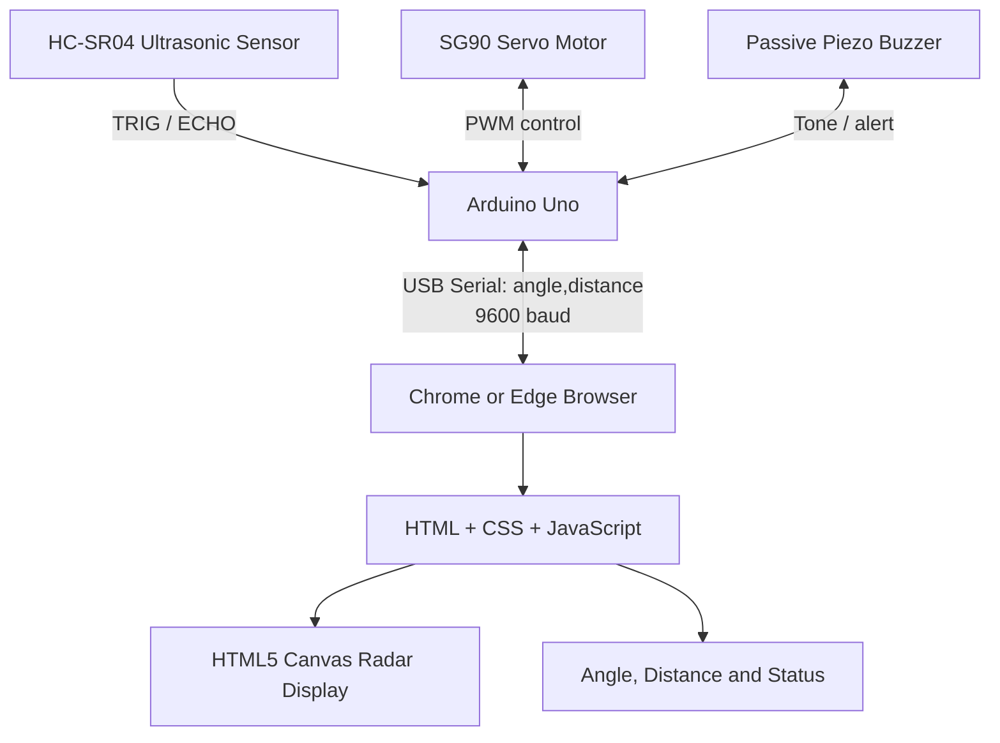

# Arduino Uno Ultrasonic Radar System with HTML5 Web Dashboard

An Arduino Uno-based ultrasonic scanning demonstrator that measures object distance with an HC-SR04 sensor mounted on an SG90 servo. Live angle and distance readings are sent over USB serial to a browser dashboard built with HTML, CSS, JavaScript, and the Web Serial API.

The dashboard renders a green radar-style sweep and object markers. A buzzer provides distance-dependent audible warnings, and the servo pauses briefly when a close object is detected.

> **Project type:** Educational ultrasonic scanning / radar-style visualization. This is not an electromagnetic or radio-frequency radar.

## Features

- HC-SR04 ultrasonic distance measurement.
- SG90 servo scanning over approximately 15°–165°.
- USB serial data stream in `angle,distance\n` format at 9600 baud.
- Browser-based radar visualization using HTML5 Canvas.
- Green radar grid and sweep line, with red close-object markers.
- Distance-dependent buzzer behaviour:
  - More than 50 cm: silent.
  - 21–50 cm: slow warning beeps.
  - 11–20 cm: faster, higher-pitched beeps.
  - 10 cm or less: continuous high-pitched warning.
- Servo pauses at the detected direction for up to one second when an object is closer than 20 cm. It resumes scanning if the measured distance rises above 25 cm or the hold period expires.
- No Processing installation is required.

## System block diagram

The following Mermaid diagram is rendered by GitHub in this README:



## Hardware

| Component | Quantity | Purpose |
|---|---:|---|
| Arduino Uno (or compatible board) | 1 | Reads sensor, controls servo and buzzer, sends serial data |
| HC-SR04 ultrasonic sensor | 1 | Measures distance to an object |
| SG90 micro servo | 1 | Rotates the ultrasonic sensor |
| Passive piezo buzzer | 1 | Supports tone/frequency variation for distance alerts |
| Breadboard | 1 | Prototyping and power distribution |
| Male-to-male jumper wires | 1 set | Breadboard and Arduino connections |
| USB cable | 1 | Arduino power, programming and serial data |
| Regulated 5 V external supply (recommended for servo) | 1 | Supplies servo current when USB/board 5 V is insufficient |

See [hardware/components-and-wiring.md](hardware/components-and-wiring.md) for the wiring table and power notes.

## Pin connections

| Module | Module pin / wire | Arduino Uno |
|---|---|---|
| HC-SR04 | VCC | 5V |
| HC-SR04 | GND | GND |
| HC-SR04 | TRIG | D10 |
| HC-SR04 | ECHO | D11 |
| SG90 | Signal (orange/yellow) | D9 |
| SG90 | VCC (red) | Regulated 5 V supply |
| SG90 | GND (brown/black) | Supply GND and Arduino GND (common ground) |
| Buzzer | Signal / positive | D8 |
| Buzzer | GND / negative | GND |

The sensor may use the Arduino 5 V and GND rails. A servo can draw current spikes that reset or destabilize an Uno; use a suitable regulated external 5 V supply if needed, and connect its ground to Arduino GND. Do not connect an external supply's positive output to the Uno 5 V pin while USB power is also connected unless the power arrangement is designed for it.

## Software

- Arduino IDE 2.x (for compiling and uploading the sketch).
- Google Chrome or Microsoft Edge on a desktop operating system with Web Serial API support.
- No Processing installation is required.
- The Web Serial page must be served from a secure context such as `http://localhost` or HTTPS. A local file may work in some browser setups, but localhost is the recommended method.

## Repository layout

```text
.
├── README.md
├── LICENSE
├── .gitignore
├── src/
│   └── ultrasonic_radar.ino
├── web/
│   └── index.html
├── hardware/
│   └── components-and-wiring.md
├── docs/
│   ├── algorithm.md
│   ├── system-architecture.md
│   ├── design-decisions.md
│   ├── testing.md
│   ├── contribution-and-ai-disclosure.md
│   └── git-workflow.md
└── media/
    └── README.md
```

## Setup and operation

### 1. Assemble the circuit

Follow the wiring table above and the detailed hardware notes. Ensure the servo and Arduino share a common ground.

### 2. Upload the Arduino sketch

1. Open `src/ultrasonic_radar.ino` in Arduino IDE.
2. Select **Arduino Uno** under Tools → Board.
3. Select the correct serial port under Tools → Port.
4. Upload the sketch.
5. Close Arduino IDE Serial Monitor before connecting the browser; only one application can normally own the serial port at a time.

### 3. Start the web dashboard

1. Open a terminal in the repository's `web/` folder.
2. Run `python -m http.server 8000` (Python 3 required).
3. Open `http://localhost:8000` in Chrome or Edge.
4. Click **Connect Arduino** and choose the Uno's COM port (for example, COM5).
5. Allow the browser's serial permission prompt.

The browser does not silently scan or select arbitrary COM ports. The user must grant permission through the device picker. After permission has been granted, the browser may remember the authorized device, but the page still needs to open the port.

### Serial protocol

Each measurement is sent as one newline-terminated text record:

```text
15,124
16,121
17,118
```

The first field is the servo angle in degrees; the second is distance in centimetres. An out-of-range / timeout reading is represented as 400 cm.

## Operating logic

- Normal scanning: 15° to 165°, then 165° to 15°.
- Close-object pause: when distance is below 20 cm, hold the current angle and re-measure for up to one second.
- Resume condition: resume early if distance rises above 25 cm.
- Buzzer thresholds and timing are implemented in the Arduino sketch. The buzzer update is non-blocking so that serial measurements and radar rendering continue during alert patterns.

See [docs/algorithm.md](docs/algorithm.md) and [docs/design-decisions.md](docs/design-decisions.md).

## Testing status

The repository contains a practical test checklist in [docs/testing.md](docs/testing.md). Actual test outcomes, measured range, and observations should be filled in after testing the assembled hardware. No successful test result is claimed by this repository unless it is recorded there.

## Limitations

- Ultrasonic reflections depend on object size, surface angle, material, and surrounding conditions.
- The HC-SR04 provides a single distance measurement along its current direction; the servo scan builds a sequence of directional measurements, not a simultaneous 2D map.
- The displayed marker is a radar-style visualization, not a calibrated target coordinate.
- The scan is limited to the servo's configured angular range.
- Web Serial is supported by Chromium-based desktop browsers; browser support and permissions vary.
- The sensor's nominal range is module- and environment-dependent. Treat 400 cm as a timeout/out-of-range sentinel in this implementation, not a guaranteed measurement.

## Contributions and AI disclosure

The project concept, hardware selection/assembly, physical wiring, project direction, and final validation belong to the student project owner to the extent actually performed. AI assistance was used to help structure the repository, draft documentation, and refine example Arduino / browser code. The exact division of work and any manual modifications should be updated in [docs/contribution-and-ai-disclosure.md](docs/contribution-and-ai-disclosure.md).

## License

This repository retains its existing MIT License. See [LICENSE](LICENSE).

## Author

**S. Divya Darshan** — individual student project.

---

If you build or modify this project, record your own wiring changes, browser version, test results, and demonstration photographs in the documentation.
